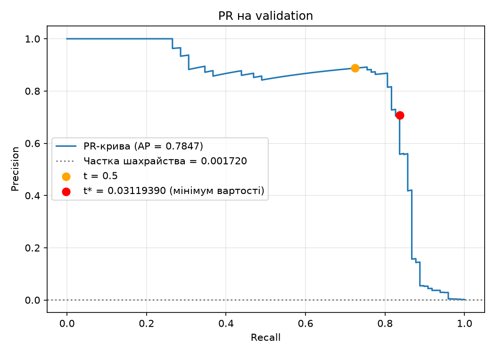
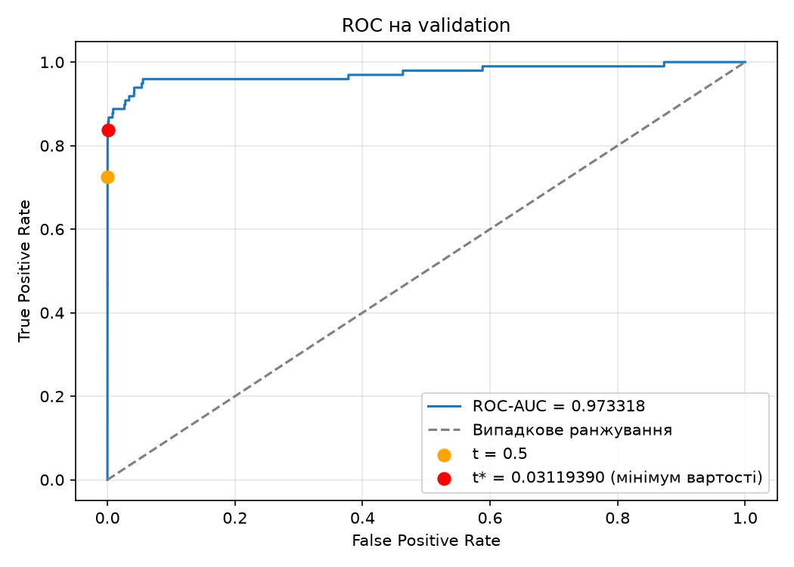

# ЛР2. Поріг рішення під асиметричну ціну помилок

Мережа: $X \rightarrow \mathrm{Linear}(29,32) \rightarrow \mathrm{ReLU} \rightarrow \mathrm{Linear}(32,1)$.
Навчається один раз; далі вся робота йде зі збереженими прогнозами. Лічильники, вартість
і пошук порога — вручну в NumPy. Коректність пошуку перевіряється незалежним прямим
перебором на трьох малих наборах A/B/C. PR- і ROC-криві — через scikit-learn.

Дані: [Credit Card Fraud Detection](https://www.kaggle.com/datasets/mlg-ulb/creditcardfraud),
284 807 транзакцій, 29 ознак, `Class=1` — шахрайство. Навчання — CPU, `float32`.

## Версії

- Python 3.12.0, NumPy 2.5.4, pandas 3.0.6
- scikit-learn 1.9.1, PyTorch 2.14.1

## Запуск

```bash
uv sync

# аналіз зі збережених прогнозів (без CSV і навчання)
uv run python lab2_analysis.py --predictions results/predictions.npz --out analysis

# повторне навчання
uv run python lab2_starter.py --data creditcard.csv --out results_retrained
```
`lab2_analysis.py` спочатку проганяє A/B/C, потім validation, фіксує $t^*$ у `analysis/threshold.json` і лише після цього оцінює test. Тека `--out` для навчання має бути новою або порожньою — тому перевірочне навчання йде в `results_retrained/`, а не поверх `results/`. Для повторного запуску видаліть або переназвіть теку перед навчанням.  Поділ і статистики відтворюються точно, оцінки $s_i$ можуть відрізнятися в молодших розрядах залежно від PyTorch і платформи — висновки зроблено за збереженими прогнозами в `results/`.

## Структура файлів

- `lab2_starter.py` — поділ даних, стандартизація, навчання моделі та збереження прогнозів.
- `lab2_analysis.py` — перевірки A/B/C, криві, пошук порога, тестова оцінка та аналіз помилок.
- `results/` — ваги `model.pt`, індекси поділу, мітки, сирі Amount та оцінки в `predictions.npz`, параметри запуску `run.json`.
- `analysis/` — результати аналізу:
  - `split_summary.csv` — розміри train/validation/test;
  - `validation_candidates.csv` — повна таблиця кандидатів на validation (55 973 рядки);
  - `validation_comparison.csv` — порівняння 0.5 / $t^*$ / $+\infty$ на validation;
  - `threshold.json` — зафіксований $t^*$ без округлення;
  - `pr_curve.png`, `roc_curve.png` — криві на validation;
  - `test_summary.csv` — матриця плутанини test при $t^*$;
  - `test_comparison.csv` — порівняння 0.5 / $t^*$ / $+\infty$ на test;
  - `test_errors.csv` — перші 5 FP і 5 FN на test;
  - `verify_A.csv`, `verify_B.csv`, `verify_C.csv` — незалежні перевірки пошуку.
- `pyproject.toml` — опис проєкту та його залежностей.
- `uv.lock` — файл фіксації версій залежностей.

## 1. Дані та поділ

284 807 транзакцій, із них 492 шахрайські. На вхід моделі — 29 ознак: `V1`–`V28` і
`Amount`; `Class` і `Time` не включено. Сирий `Amount` зберігається окремо для аналізу.

Індекси `np.arange(len(y))` діляться двома `train_test_split`: спочатку 40%
(`test_size=0.4`, `stratify=Class`, `random_state=0`), потім відкладені — навпіл
(`test_size=0.5`, стратифікація, `random_state=0`): перша частина — validation, друга —
test. Початковий порядок рядків CSV зберігається, `row_id` — індекс рядка від 0.

| Вибірка | Об'єктів | Шахрайських | Легітимних | Частка шахрайських |
|---|---:|---:|---:|---:|
| Train | 170 884 | 295 | 170 589 | 0.172632 % |
| Validation | 56 961 | 98 | 56 863 | 0.172048 % |
| Test | 56 962 | 99 | 56 863 | 0.173800 % |

`StandardScaler` навчено лише на train; до validation і test застосовано ті самі
$\mu_j,\sigma_j$:

$$
X'_{ij} = \frac{X_{ij} - \mu_j}{\sigma_j}.
$$

Масиви переведено у `float32`. Класи не балансуються.

Статистики **не можна** рахувати на всьому наборі: тоді в $\mu,\sigma$ потрапила б
інформація з validation і test, модель опосередковано «підглянула» б test, і він
перестав би імітувати невідомі дані. Це витік (leakage): метрики на test виходять
завищеними. У продакшені scaler теж навчається лише на історичних даних.

## 2. Модель і навчання

| Параметр | Значення |
|---|---|
| Архітектура | `Linear(29,32)` → `ReLU` → `Linear(32,1)` |
| Ініціалізація | стандартна `nn.Linear` |
| Втрата | `BCEWithLogitsLoss`, середнє за пакетом, без ваг класів |
| Оптимізатор | Adam, lr $10^{-3}$ |
| Епохи / пакет | 12 / 1024 (останній неповний не відкидається) |
| Зерно | `torch.manual_seed(0)` перед створенням моделі |
| Перемішування | `np.random.default_rng(0)`, нова перестановка щоразу |
| Пристрій | CPU, `float32` |

Взято ваги після 12-ї епохи (епоха за validation не вибирається). BCE: `0.365299`
→ `0.003383`.

## 3. Оцінки, метрики та вартість

Після `model.eval()` без градієнтів:

$$
s_i = \sigma(z_i) = \frac{1}{1+e^{-z_i}}.
$$

Ваги в `results/model.pt`; мітки, Amount, індекси й оцінки без округлення —
в `results/predictions.npz`.

Для порога $t$: $\widehat y_i = \mathbf 1[s_i \ge t]$,

$$
TP=\sum_i \mathbf 1[y_i{=}1,\ s_i\ge t],\quad
FP=\sum_i \mathbf 1[y_i{=}0,\ s_i\ge t],\quad
FN=\sum_i \mathbf 1[y_i{=}1,\ s_i<t],\quad
TN=\sum_i \mathbf 1[y_i{=}0,\ s_i<t].
$$

$$
C(t)=10\,FN(t)+FP(t),\qquad
\mathrm{precision}=\frac{TP}{TP+FP},\qquad
\mathrm{recall}=\frac{TP}{TP+FN}.
$$

`Amount` у вартість не входить. Якщо $TP+FP=0$ — precision не визначена (немає
позитивних прогнозів); якщо $TP+FN=0$ — recall не визначений (немає позитивних міток).

## 4. Пошук порога на validation

Кандидати: усі унікальні оцінки validation плюс $+\infty$ («усі негативні»).
Найменша оцінка = «усі позитивні».

`table_fast()` сортує оцінки за спаданням і бере кумулятивні суми на кінці кожної
групи рівних оцінок:

$$
TP_k=\sum_{i=0}^{k} y_{(i)},\quad FP_k=(k+1)-TP_k,\quad
FN_k=P-TP_k,\quad TN_k=N-FP_k.
$$

Рядок $+\infty$ додається окремо ($TP=FP=0$, $FN=P$). Складність $O(n\log n)$ —
сортування; проходу по вибірці для кожного порога немає.

Рівні оцінки переходять поріг разом (правило $s_i\ge t$ не може включити лише
частину групи), тому лічильники беруться саме на кінці групи. При рівній вартості
на кількох порогах обирається **більший**: таблиця йде за спадним порогом, а
`argmin` повертає перше входження мінімуму.

Повна таблиця — [`analysis/validation_candidates.csv`](analysis/validation_candidates.csv),
**55 973 кандидати** (55 972 унікальні оцінки + `+∞`).

| Правило | Поріг | TP | FP | FN | TN | C |
|---|---:|---:|---:|---:|---:|---:|
| Стандартний | `0.5` | 71 | 9 | 27 | 56 854 | 279 |
| Мінімум | $t^*$ = `0.031193897128105164` | 82 | 34 | 16 | 56 829 | 194 |
| Усі негативні | $+\infty$ | 0 | 0 | 98 | 56 863 | 980 |

$t^*$ зафіксовано в [`analysis/threshold.json`](analysis/threshold.json) до test —
у повному вигляді, без округлення. У тексті звіту `0.03119390` — це скорочення
лише для відображення.

## 5. PR- і ROC-криві на validation





Червона точка — $t^*$, оранжева — `0.5`.

ROC-AUC = **0.973318**, Average Precision = **0.784727**.

**Чому високий ROC-AUC не гарантує малої $C$ і високої precision:**

- ROC-AUC — характеристика ранжування загалом, від конкретного порога не залежить.
  Для `0.5` і $t^*$ вона однакова, а $C$ відрізняється (279 vs 194).
- Вартість залежить від порога і від співвідношення штрафів $10{:}1$; оптимум
  зміщується в бік більшого recall — ціною FP.
- При $t^*$ precision $=82/116 \approx 0.71$, FPR $=34/56863 \approx 0.06\%$. Навіть
  така мала FPR дає 34 хибні тривоги серед 116 спрацювань.
- Отже, ROC-AUC не враховує асиметрію $10{:}1$ — тому $t^*$ обирається за мінімумом
  $C(t)$, а не за ROC-AUC чи precision.

## 6. Незалежна перевірка пошуку

Еталон у `table_brute()` окремо формує кандидатів через `set` і `sorted` та для
кожного застосовує $s_i\ge t$ в прямому циклі. Кумулятивні суми й лічильники
швидкого алгоритму **не** використовуються. Еталонні таблиці — `analysis/verify_A/B/C.csv`.

Умова проходження: усі пороги, лічильники та $C$ збігаються точно, без допусків;
обраний поріг відповідає тому самому tie-break. Перевірки виконуються до test.

### Набір A — `[0.9, 0.7, 0.7, 0.4, 0.2, 0.1]`, `[0, 1, 0, 1, 0, 0]`

| Поріг | TP | FP | FN | TN | C (fast) | C (brute) | Збіг |
|---:|---:|---:|---:|---:|---:|---:|:---:|
| $+\infty$ | 0 | 0 | 2 | 4 | 20 | 20 | так |
| 0.9 | 0 | 1 | 2 | 3 | 21 | 21 | так |
| 0.7 | 1 | 2 | 1 | 2 | 12 | 12 | так |
| 0.4 | 2 | 2 | 0 | 2 | 2 | 2 | так |
| 0.2 | 2 | 3 | 0 | 1 | 3 | 3 | так |
| 0.1 | 2 | 4 | 0 | 0 | 4 | 4 | так |

Обрано `0.4`. Що перевіряє: дві оцінки `0.7` з різними мітками переходять поріг
**одночасно** — при $t=0.7$ маємо $TP=1$, $FP=2$ (одна `0.7/y=1` і друга `0.7/y=0`).
Варіант «включити лише одну з `0.7`» не виникає.

### Набір B — `[0.9, 0.6, 0.3]`, `[0, 0, 0]`

| Поріг | TP | FP | FN | TN | C (fast) | C (brute) | Збіг |
|---:|---:|---:|---:|---:|---:|---:|:---:|
| $+\infty$ | 0 | 0 | 0 | 3 | 0 | 0 | так |
| 0.9 | 0 | 1 | 0 | 2 | 1 | 1 | так |
| 0.6 | 0 | 2 | 0 | 1 | 2 | 2 | так |
| 0.3 | 0 | 3 | 0 | 0 | 3 | 3 | так |

Обрано $+\infty$. Що перевіряє: відсутність позитивних міток — кожне спрацювання
додає лише FP, тож мінімум $C=0$ лише при «усі негативні». Recall не визначений
($TP+FN=0$).

### Набір C — `[0.8, 0.5 (×11), 0.2]`, `[1, 1, 0 (×10), 0]`

| Поріг | TP | FP | FN | TN | C (fast) | C (brute) | Збіг |
|---:|---:|---:|---:|---:|---:|---:|:---:|
| $+\infty$ | 0 | 0 | 2 | 11 | 20 | 20 | так |
| 0.8 | 1 | 0 | 1 | 11 | 10 | 10 | так |
| 0.5 | 2 | 10 | 0 | 1 | 10 | 10 | так |
| 0.2 | 2 | 11 | 0 | 0 | 11 | 11 | так |

Обрано `0.8`. Що перевіряє: два кандидати з однаковою $C=10$. При `0.5` група з
11 оцінок `0.5` дає одночасно +1 TP (мінус 10 до $C$) і +10 FP (плюс 10 до $C$) —
та сама вартість. Нічия, tie-break обирає більший поріг `0.8`.

Усі три перевірки пройдено до оцінки test.

## 7. Тестова оцінка

До test застосовано **зафіксований** $t^*$ — без будь-якого підбору. Для контексту —
рядки `0.5` і $+\infty$ (стандартний і крайній випадки; повна таблиця в
[`analysis/test_comparison.csv`](analysis/test_comparison.csv)).

| Правило | Поріг | TP | FP | FN | TN | C | Precision | Recall |
|---|---:|---:|---:|---:|---:|---:|---:|---:|
| **Поріг із validation** | `0.031193897128105164` | **80** | **43** | **19** | **56 820** | **233** | **0.650407** | **0.808081** |
| Стандартний | `0.5` | 71 | 8 | 28 | 56 855 | 288 | 0.898734 | 0.717172 |
| Усі негативні | $+\infty$ | 0 | 0 | 99 | 56 863 | 990 | не визначена | 0 |

Матриця плутанини при $t^*$:

| Фактичний клас | Прогноз 0 | Прогноз 1 |
|---|---:|---:|
| 0, легітимна | 56 820 ($TN$) | 43 ($FP$) |
| 1, шахрайство | 19 ($FN$) | 80 ($TP$) |

$$
\mathrm{precision}=\frac{80}{123}\approx0.650407,\qquad
\mathrm{recall}=\frac{80}{99}\approx0.808081,\qquad
C=10\cdot19+43=233.
$$

## 8. Аналіз FP і FN

Перші п'ять FP і перші п'ять FN за номером рядка CSV (0, без заголовка):

| Рядок CSV | Тип | Мітка | $s$ | Amount | $\lvert s-t^*\rvert$ |
|---:|:---:|---:|---:|---:|---:|
| 460 | FP | 0 | 0.196159 | 2.00 | 0.164965 |
| 2 961 | FP | 0 | 0.080961 | 2.49 | 0.049767 |
| 10 783 | FP | 0 | 0.966327 | 89.99 | 0.935133 |
| 13 405 | FP | 0 | 0.932032 | 89.99 | 0.900838 |
| 13 617 | FP | 0 | 0.922762 | 89.99 | 0.891568 |
| 10 497 | FN | 1 | 0.011464 | 3.79 | 0.019730 |
| 52 521 | FN | 1 | 0.006373 | 105.99 | 0.024821 |
| 55 401 | FN | 1 | 0.005642 | 1.00 | 0.025552 |
| 91 671 | FN | 1 | 0.000500 | 290.18 | 0.030693 |
| 93 486 | FN | 1 | 0.018352 | 0.00 | 0.012842 |

`Amount` — сира сума. У FP — 2.00–89.99, у FN — 0.00–290.18. Серед FP три з п'яти
мають Amount 89.99 і $s>0.92$; серед FN найбільша сума (290.18) має найнижчу оцінку
(0.0005). Відстані: FP — 0.05–0.94 (розсіяні далеко), FN — 0.013–0.031 (усі близько
до $t^*$ знизу).

За десятьма прикладами **не можна** судити про причини: вибірка мала, відібрана за
номером рядка (не випадково), а `Amount` — лише одна з 29 ознак. Три FP з Amount 89.99
— цікавий збіг, але не доказ. Для висновків треба аналіз розподілів усіх ознак на
всіх 43 FP і 19 FN.

## 9. Висновки

- **Що змінив вибір порога.** Ваги, логіти й ранжування лишилися тими самими —
  змінилося тільки рішення. На validation $C$ впала з 279 до 194 (на 85, −30.5 %).
- **Ціна цього рішення в FP і FN.** На validation: $FN$ 27→16 (−11), $FP$ 9→34 (+25).
  На test: $FN$ 28→19 (−9), $FP$ 8→43 (+35), $C$ 288→233 (−55, −19.1 %).
  Precision 0.899→0.650, recall 0.717→0.808 — знайшли більше шахрайства ціною
  більшої кількості хибних тривог.
- **Чому виграш на validation не гарантує такого самого на test.** Поріг підібрано
  за 98 positives validation; на test їх 99, і оцінки біля межі розташовані інакше.
  Тому виграш на test (55) менший за виграш на validation (85). Перепідбір порога
  на test перетворив би його на ще одну validation-вибірку й порушив би незалежність
  оцінки — тому test використано лише для фінального звіту.

## 10. Джерела

1. Умова «ЛР2. Поріг рішення під асиметричну ціну помилок» та стартовий код викладача.
2. [Credit Card Fraud Detection, MLG–ULB](https://www.kaggle.com/datasets/mlg-ulb/creditcardfraud).
3. [PyTorch — `BCEWithLogitsLoss`](https://docs.pytorch.org/docs/stable/generated/torch.nn.BCEWithLogitsLoss.html).
4. [scikit-learn — `precision_recall_curve`](https://scikit-learn.org/stable/modules/generated/sklearn.metrics.precision_recall_curve.html).
5. [scikit-learn — ROC-метрики](https://scikit-learn.org/stable/modules/model_evaluation.html#roc-metrics).
6. Claude (Anthropic) — допомога з поясненням формул, реалізацією коду аналізу та структуруванням README.