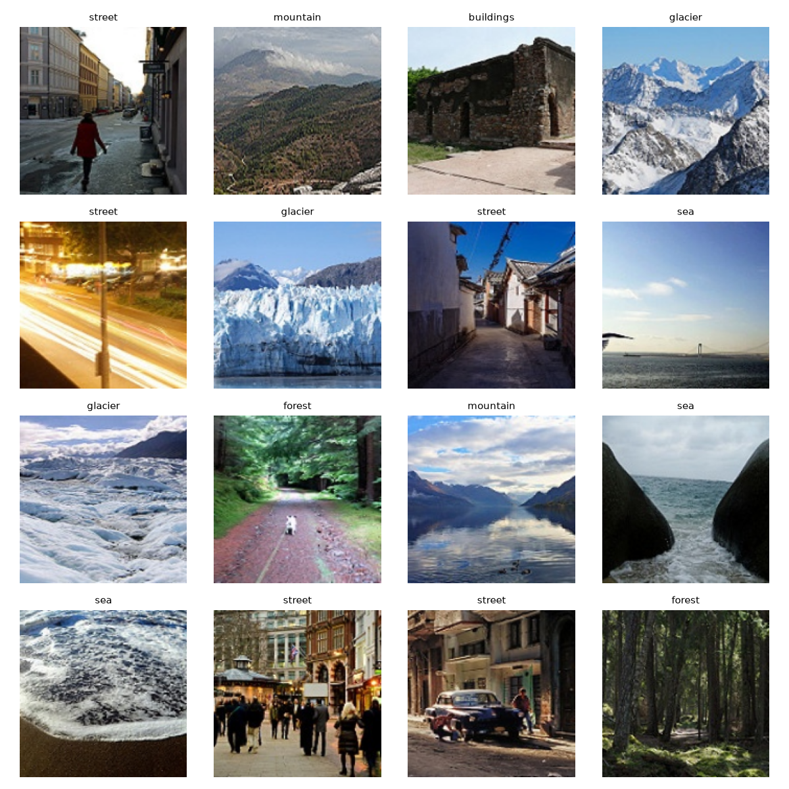
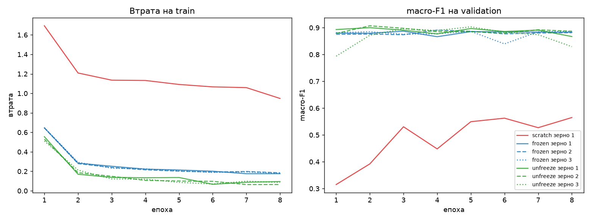
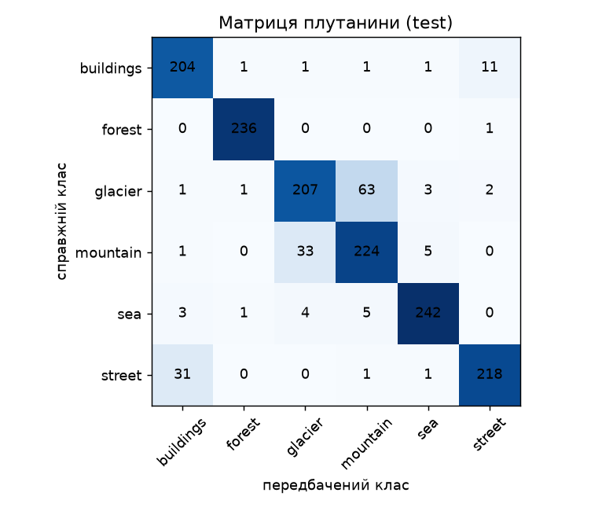
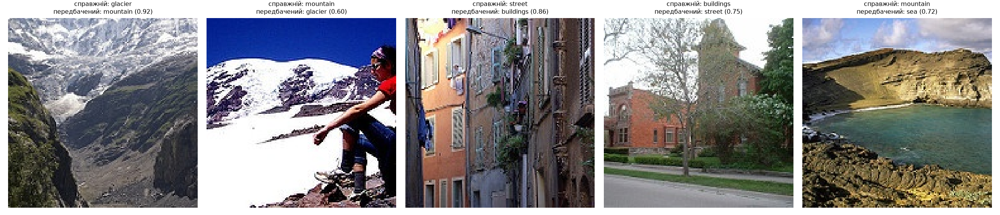

# ЛР3. Обчислювальний експеримент і трансферне навчання

## Мета роботи

Порівняти три режими навчання ResNet-18 на малій вибірці (200 зображень на клас) за однакового обчислювального бюджету:

- `scratch` — навчання всієї мережі з випадкової ініціалізації;
- `frozen` — ваги ImageNet, навчається лише голова `fc`;
- `unfreeze` — ваги ImageNet, навчаються `layer4` і `fc`.

Потрібно виміряти ефект попередньо навчених ознак $\Delta_{pre}$ та ефект розморожування $\Delta_{unf}$, порівняти їх із розкидом між зернами $R$ і оцінити вибрану конфігурацію на test.

Бюджет усіх режимів однаковий: 8 епох × 38 кроків = 304 кроки оптимізатора (1200 зображень, batch 32, останній пакет епохи містить 16 зображень).

## Дані та поділ

Використано набір [Intel Image Classification](https://www.kaggle.com/datasets/puneet6060/intel-image-classification) (папки `seg_train` і `seg_test`; `seg_pred` не використовується). Порядок класів: buildings, forest, glacier, mountain, sea, street.

**Формування вибірок.** Для навчання взято по 200 зображень кожного класу з `seg_train` (разом 1200). Перед вибором імена файлів кожного класу впорядковано як рядки; індекси перемішано генератором `numpy.random.default_rng(0)`, створеним один раз для всіх класів у фіксованому порядку. Набір `seg_test` поділено окремо для кожного класу: після впорядкування й перемішування новим генератором із зерном 0 першу половину зображень (округлену вниз) віднесено до `validation` (1498), решту — до `test` (1502). Перелік файлів і належність до вибірок збережено в `split.csv`.

## Модель і попередня обробка

Використано ResNet-18 із `torchvision`. Для режимів `frozen` і `unfreeze` завантажено ваги ImageNet (`IMAGENET1K_V1`); у режимі `scratch` мережу ініціалізовано випадково. Класифікаційну голову `fc` замінено на `Linear(512, 6)`.

Усі зображення приведено до розміру 160 × 160 і нормалізовано за середніми та стандартними відхиленнями ImageNet (в усіх режимах однаково). Під час навчання додатково застосовано `RandomResizedCrop` (масштаб 0,7–1,0) і горизонтальне відбиття. Для validation і test використано лише масштабування та нормалізацію. Оптимізатор — AdamW (`weight_decay = 1e-4`), швидкості навчання: $3\cdot10^{-3}$ для `fc` і для `scratch`, $3\cdot10^{-4}$ для `layer4` у `unfreeze`.

## Відтворення

Потрібні Python 3.12 та [uv](https://docs.astral.sh/uv/). Набір даних не входить до репозиторію; потрібно вказати шлях до папки, у якій лежать `seg_train` і `seg_test`.

```bash
cd lab3
uv sync

# Команда 1: поділ, перевірки (пп. 1–2), сім запусків, вибір і збереження lab3_model.pt
uv run python train.py --data "ШЛЯХ/ДО/archive"

# Команда 2: аналіз журналів, тест на CPU, матриця плутанини, п'ять помилок
uv run python analyze.py --data "ШЛЯХ/ДО/archive"
```

Додатково: `train.py --checks-only` виконує лише перевірки пунктів 1–2 і зупиняється; `--skip-checks` пропускає їх.

## Структура файлів

| Файл | Призначення |
|---|---|
| `common.py` | поділ, датасет, модель, режими, оптимізатор, цикл навчання, вибір конфігурації |
| `checks.py` | перевірки пунктів 1–2 (поділ, пакет, початкова втрата, параметри, дослід із BN) |
| `train.py` | команда 1: перевірки, сім запусків, збереження `lab3_model.pt` |
| `analyze.py` | команда 2: таблиця, криві, ефекти, перевірка вибору, тест, матриця плутанини, п'ять помилок |
| `split.csv` | поділ даних (train / validation / test) |
| `runs/<режим>_seed<зерно>/` | `run.json` і `val_logits.npy` кожного з семи запусків |
| `lab3_model.pt` | вибрана модель (використовується в ЛР4) |
| `fig_*.png` | рисунки |
| `checks_log.txt`, `train_log.txt`, `analyze_log.txt` | збережений вивід відповідних команд |

## Прогноз до проведення експериментів

*Записано до запуску перевірок.*

### Дослід із навмисною помилкою (`model.train()` замість `set_train_mode`, режим `frozen`)

- **Параметри заморожених модулів не зміняться.** Для них `requires_grad=False`, градієнти не рахуються, і в оптимізатор вони не передані.
- **Ковзні статистики BN у замороженому кістяку зміняться** (`running_mean`, `running_var`, а також `num_batches_tracked`). У режимі `train()` шар BatchNorm під час прямого проходу нормалізує за статистикою поточного пакета й оновлює ковзні статистики. `requires_grad=False` забороняє оновлення параметрів градієнтним спуском, але не впливає на буфери BN. Тому статистики BN у замороженому кістяку змінюватимуться відповідно до розподілу нових пакетів, хоча самі ваги кістяка залишаться незмінними.
- **На кривій втрати на train це, найімовірніше, майже не буде помітно.** Голова `fc` навчається зі швидкістю $3\cdot10^{-3}$ і може підлаштуватися під зміщені ознаки, тому втрата спадатиме плавно в обох випадках. Отже, крива втрати не здатна виявити цю помилку; потрібна пряма перевірка `state_dict` (порівняння тензорів).

### Початкова втрата $L_0$

Втрата рівномірної моделі: $\ln 6 \approx 1{,}792$.

- **scratch:** очікується значення поблизу $\ln 6$. Ймовірності при випадковій ініціалізації лише приблизно рівномірні, тому невелике відхилення нормальне.
- **frozen:** також очікую значення поблизу $\ln 6$, імовірно трохи вище. Це гіпотеза: ознаки ImageNet після глобального усереднення мають більший масштаб, тому логіти випадково ініціалізованої голови можуть бути більш розкиданими. Гіпотезу буде зіставлено з фактичними числами.

## Результати

### 1. Перевірки до навчання

- **Контроль поділу.** Усі 18 клітинок «кількість / сума номерів» збігаються з контрольною таблицею; файли не перетинаються між train, validation і test. Повний вивід — у `checks_log.txt`.
- **Пакет після перетворень.** Перші 16 зображень першого навчального пакета (після аугментацій, з оберненим нормуванням, із підписами класів) подано на рисунку `fig_batch.png`.



- **Початкова втрата** (зерно 1, перший пакет train, після `set_train_mode`, без кроків оптимізатора): scratch $L_0 = 2{,}134$, frozen $L_0 = 2{,}216$; $\ln 6 \approx 1{,}792$. Обидва значення вищі за $\ln 6$ (на 0,34 і 0,42), тобто прогноз «поблизу $\ln 6$» виявився неточним. Можливе пояснення: логіти випадково ініціалізованої голови `fc` мають ненульову дисперсію, через що очікувана втрата перевищує $\ln 6$. Цей вплив кількісно не перевірявся, тому пояснення є гіпотезою. Вимірювання зроблено на одному пакеті, тому воно шумне.
- **Параметри та групи оптимізатора:**

| Режим | Усього | Навчаються | Групи AdamW (параметрів, lr) |
|---|---|---|---|
| scratch | 11 179 590 | 11 179 590 | (11 179 590; 3e-3) |
| frozen | 11 179 590 | 3 078 | (3 078; 3e-3) |
| unfreeze | 11 179 590 | 8 396 806 | (3 078; 3e-3), (8 393 728; 3e-4) |

Заморожених параметрів в оптимізаторі немає; `weight_decay = 1e-4` в усіх групах. Числа збігаються з таблицею режимів із завдання.

- **Що змінюється впродовж 5 кроків** (порівняння `torch.equal`, без допуску; «збігається» означає збіг з очікуваним):

Режим `frozen` (правильний `set_train_mode`):

| Модуль | Параметри змінилися | Ковзні статистики BN змінилися | Збігається |
|---|---|---|---|
| conv1 | ні | немає BN | так |
| bn1 | ні | ні | так |
| layer1 | ні | ні | так |
| layer2 | ні | ні | так |
| layer3 | ні | ні | так |
| layer4 | ні | ні | так |
| fc | так | немає BN | так |

Режим `unfreeze` (правильний `set_train_mode`):

| Модуль | Параметри змінилися | Ковзні статистики BN змінилися | Збігається |
|---|---|---|---|
| conv1 | ні | немає BN | так |
| bn1 | ні | ні | так |
| layer1 | ні | ні | так |
| layer2 | ні | ні | так |
| layer3 | ні | ні | так |
| layer4 | так | так | так |
| fc | так | немає BN | так |

- **Дослід із навмисною помилкою** (`frozen`, `model.train()` замість `set_train_mode`):

| Модуль | Параметри змінилися | Ковзні статистики BN змінилися | Збігається з очікуваним |
|---|---|---|---|
| conv1 | ні | немає BN | так |
| bn1 | ні | так | ні |
| layer1 | ні | так | ні |
| layer2 | ні | так | ні |
| layer3 | ні | так | ні |
| layer4 | ні | так | ні |
| fc | так | немає BN | так |

У `layer1.0.bn1` після 5 кроків: максимальна абсолютна зміна `running_mean` дорівнює 8,858·10⁻², `running_var` — 1,484·10⁻¹. Прогноз щодо параметрів і статистик підтвердився. Щодо кривої втрати: перевірка охоплювала лише 5 кроків без побудови кривої, тому це твердження прогнозу залишається непідтвердженим.

**Чому `requires_grad=False` не захищає статистики BN.** Цей прапорець лише забороняє обчислення градієнтів і оновлення параметрів оптимізатором. Ковзні `running_mean` і `running_var` є буферами, а не параметрами; у режимі `train()` вони оновлюються під час прямого проходу незалежно від градієнтів. Захищає лише перемикання модуля в `eval()`.

**Чому для `layer4` в `unfreeze` оновлення правильне.** Ваги `layer4` змінюються під нову задачу, тому змінюється розподіл їхніх активацій, і ковзні статистики мають відповідати цьому новому розподілу. В `eval()` вони залишилися б статистиками ImageNet і не відповідали б навчуваним вагам.

### 2. Сім запусків

| # | Режим | Зерно | Втрата train (епоха 8) | macro-F1 validation (епоха 8) | Час навчання, с |
|---|---|---|---|---|---|
| 1 | scratch | 1 | 0,9478 | 0,5649 | 193 |
| 2 | frozen | 1 | 0,1759 | 0,8829 | 67 |
| 3 | frozen | 2 | 0,1848 | 0,8814 | 67 |
| 4 | frozen | 3 | 0,1788 | 0,8864 | 67 |
| 5 | unfreeze | 1 | 0,0950 | 0,8671 | 94 |
| 6 | unfreeze | 2 | 0,0647 | 0,8869 | 95 |
| 7 | unfreeze | 3 | 0,0858 | 0,8293 | 95 |

Криві втрати на train та macro-F1 на validation для всіх семи запусків подано на рисунку `fig_curves.png`. Час навчання вимірювався лише по циклу навчання, без валідації після епох; пристрій — CPU.



### 3. Розклад ефектів

$$\Delta_{pre} = \bar F_{frozen} - F_{scratch,1}, \qquad \Delta_{unf} = \bar F_{unfreeze} - \bar F_{frozen}, \qquad R = \max(R_{frozen}, R_{unfreeze})$$

| Величина | Значення |
|---|---|
| $F_{scratch,1}$ | 0,5649 |
| $\bar F_{frozen}$; $R_{frozen}$ | 0,8836; 0,0051 |
| $\bar F_{unfreeze}$; $R_{unfreeze}$ | 0,8611; 0,0576 |
| $R$ | 0,0576 |
| $\Delta_{pre}$ | +0,3186 ($\lvert\Delta\rvert > R$) |
| $\Delta_{unf}$ | −0,0225 ($\lvert\Delta\rvert \le R$) |
| $\Delta_{pre}+\Delta_{unf}$ | +0,2962 $= \bar F_{unfreeze} - F_{scratch,1}$ |

**Що змінює зерно.** У всіх режимах зерно визначає початкову ініціалізацію голови `fc`, порядок пакетів і випадкові аугментації (обрізання та відбиття). У `scratch` воно додатково визначає ініціалізацію всієї мережі. Ваги ImageNet від зерна не залежать. У `frozen` навчаються лише 3 078 параметрів лінійної голови над незмінними ознаками, тому результат слабко залежить від зерна, а розкид малий ($R_{frozen}=0{,}0051$). У `unfreeze` додатково навчається `layer4` (8,4 млн параметрів), і результат чутливіший до порядку пакетів та аугментацій: $R_{unfreeze}=0{,}0576$, приблизно в 11 разів більше. Зерно 3 у `unfreeze` мало F1 0,79 на епосі 1 і завершило на 0,83. Оскільки вибору епохи немає, значення на епосі 8 залежить від випадкового стану навчання в цей момент.

**Чому $R$, виміряний на запусках 2–7, не характеризує запуск 1.** Режим `scratch` має одне зерно, а $R$ виміряно лише для `frozen` і `unfreeze`, де динаміка навчання інша. Розкид `scratch` між зернами невідомий і міг би бути більшим, оскільки випадковою є вся ініціалізація. За кривою запуску 1 (`fig_curves.png`): F1 на епохах 5–8 коливається в межах 0,527–0,565, а втрата ще знижується (0,95 на епосі 8), тобто навчання не вийшло на плато. Різниця $\Delta_{pre}=0{,}32$ значно перевищує спостережуваний розкид у режимах `frozen` і `unfreeze` і коливання кривої запуску 1, що свідчить на користь суттєвої переваги попередньо навчених ознак. Водночас через відсутність повторних запусків `scratch` оцінити невизначеність цієї різниці неможливо.

**Бюджет за часом.** Бюджет однаковий за кроками (304), але не за часом: `scratch` — 193 с (приблизно в 2,9 раза довше за `frozen`), `unfreeze` — 94–95 с (у 1,4 раза довше), `frozen` — 67 с. У `frozen` зворотний прохід іде лише через голову, у `unfreeze` — через `layer4` і голову, у `scratch` — через усю мережу.

### 4. Вибір конфігурації і тестова оцінка

Вибір зроблено лише за validation: режим із найбільшим $\bar F_r$ — `frozen` (0,8836 проти 0,8611 в `unfreeze`); у ньому запуск із найбільшим $F_{r,s}$ — зерно 3 (0,8864). Оскільки $\lvert\Delta_{unf}\rvert \le R$, **вибір між `frozen` і `unfreeze` визначив шум**; процедура вибору від цього не змінюється. Додатково слід зазначити, що frozen має менший розкид між запусками, проте підставою вибору за правилом є саме середнє $\bar F_r$. Ваги збережено як `lab3_model.pt`.

Test обчислено один раз у команді аналізу, на CPU: **macro-F1 = 0,8892**, accuracy = 0,8862, SE ≈ 0,0082 (за формулою $\sqrt{p(1-p)/n}$, $n=1502$, $p$ — accuracy).

Матриця плутанини (рядки — справжній клас, стовпці — передбачений):

| | buildings | forest | glacier | mountain | sea | street |
|---|---|---|---|---|---|---|
| buildings | 204 | 1 | 1 | 1 | 1 | 11 |
| forest | 0 | 236 | 0 | 0 | 0 | 1 |
| glacier | 1 | 1 | 207 | 63 | 3 | 2 |
| mountain | 1 | 0 | 33 | 224 | 5 | 0 |
| sea | 3 | 1 | 4 | 5 | 242 | 0 |
| street | 31 | 0 | 0 | 1 | 1 | 218 |



**Порівняння з validation і зміщення відбору.** macro-F1 на test (0,8892) на 0,0028 вищий за validation вибраного запуску (0,8864). Вибір найкращого з трьох запусків робить validation-оцінку оптимістично зміщеною, проте в цих числах таке зміщення не видно. Як груба оцінка порядку шуму від скінченності вибірки, стандартна похибка частки правильних відповідей $\sqrt{p(1-p)/n} \approx 0{,}008$ ($p \approx 0{,}886$, $n = 1502$) приблизно втричі перевищує спостережену різницю 0,0028. Validation і test є різними випадковими половинами `seg_test`, тож їхня різниця визначається переважно вибірковим шумом, який може приховати оптимістичний зсув або навіть змінити знак різниці на протилежний. Оцінка стосується accuracy і застосовується до macro-F1 лише як порядок величини.

### 5. П'ять характерних помилок

Таблицю взято з виводу `analyze.py`; зображення подано на рисунку `fig_errors.png`.

| Файл | Справжній | Передбачений | Імовірність | Кількість таких помилок | Категорія |
|---|---|---|---|---|---|
| 20179.jpg | glacier | mountain | 0,920 | 63 | Сцена містить обидва класи: гірська долина з кам'янистими схилами і льодовиковим язиком угорі; прогноз спирається на гірські елементи кадру. |
| 20116.jpg | mountain | glacier | 0,600 | 33 | Сцена містить обидва класи: скелясті піки на тлі великого снігово-крижаного поля; низька ймовірність (0,60) свідчить про невизначеність прогнозу. |
| 20353.jpg | street | buildings | 0,864 | 31 | Сцена містить обидва класи: вузька вулиця, де через ракурс переважну частину кадру займають фасади будинків. |
| 20752.jpg | buildings | street | 0,750 | 11 | Сцена містить обидва класи: цегляна будівля на задньому плані та широка дорога з газоном на передньому, що займає значну частину кадру. |
| 20304.jpg | mountain | sea | 0,721 | 5 | Ймовірна помилка розмітки: на знімку скелястий пагорб і велика водойма (бухта), прогноз «sea» узгоджується з видимим вмістом, а мітка «mountain» видається сумнівною. |



Найбільша кількість помилок пов'язана з взаємною плутаниною `glacier` і `mountain` (63 + 33 = 96 із 171 помилки, тобто понад половина). Ці класи візуально перекриваються (засніжені гірські схили, льодовикові язики), тож ця плутанина є властивістю набору; її не виправляли.

## Висновок

**Ефект попередньо навчених ознак ($\Delta_{pre}$).** Ефект додатний: використання ознак ImageNet підвищує macro-F1 на validation з 0,5649 (`scratch`) до 0,8836 (середнє `frozen`), тобто на +0,3186. Співвідношення з розкидом: $\lvert\Delta_{pre}\rvert = 0{,}3186 > R = 0{,}0576$ (приблизно в 5,5 раза). Згідно з правилом інтерпретації, ефект заслуговує на перевірку, але не є остаточно доведеним: режим `scratch` представлений одним запуском, і його власний розкид не виміряно. Надійніша оцінка потребує додаткових запусків `scratch` з іншими зернами.

**Ефект розморожування ($\Delta_{unf}$).** Ефект від'ємний: донавчання `layer4` не підвищило середній validation macro-F1, який зменшився на 0,0225 (з 0,8836 до 0,8611). Співвідношення з розкидом: $\lvert\Delta_{unf}\rvert = 0{,}0225 \le R = 0{,}0576$. Різниця не відрізняється від розкиду між запусками, тому результату немає: за наявними даними не можна ані підтвердити, ані спростувати вплив розморожування. Нижча втрата на train у `unfreeze` (0,06–0,10 проти 0,17–0,18 у `frozen`) за відсутності покращення на validation узгоджується з перепідгонкою до 1200 навчальних зображень; ця гіпотеза окремо не перевірялася.

**Обмеження.** Обидва ефекти виміряно за фіксованого бюджету 304 кроки оптимізатора; за довшого навчання `scratch` міг би зменшити відставання.

**Рекомендація для нової задачі з 200 зображеннями на клас.** Доцільно обрати режим `frozen`. Його середній validation macro-F1 не поступається `unfreeze` у межах шуму, розкид між зернами значно менший ($R_{frozen} = 0{,}0051$ проти $R_{unfreeze} = 0{,}0576$), а навчання коротше (67 с проти 94–95 с). Режим `scratch` за цих умов суттєво поступається обом режимам із попередньо навченими вагами.

## Відхилення від фіксованих налаштувань

Відхилень від фіксованих налаштувань експерименту немає. Час навчання вимірювався лише протягом циклу навчання, без урахування валідації. Усі запуски виконано на CPU. Версії бібліотек зафіксовано у `uv.lock` і `requirements.txt`.

Усі сім запусків виконано на одному коміті Git (`e87b66c`); незакомічених змін у робочій копії не було (`git_dirty = false` у всіх журналах).

## Джерела
1. Умова лабораторної роботи «ЛР3. Обчислювальний експеримент і трансферне навчання»
2. Intel Image Classification Dataset. Kaggle: [Intel Image Classification](https://www.kaggle.com/datasets/puneet6060/intel-image-classification).
3. Claude (Anthropic) — допомога з поясненням формул, реалізацією коду та структуруванням README.
